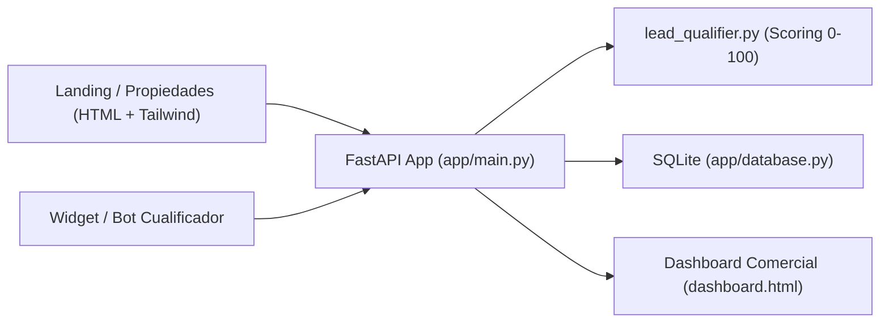

# 🏡 Inmo LeadFlow

Sistema de captación y cualificación automática de leads inmobiliarios en **FastAPI**, con landing page orientada a conversión móvil, asistente conversacional con **motor de scoring (0–100)** y panel de gestión comercial.

---

## 🏗️ Arquitectura



### Estructura del Proyecto
```text
inmo_leadflow/
├── app/
│   ├── main.py             # API FastAPI y rutas de vistas/leads
│   ├── database.py         # Persistencia SQLite
│   ├── lead_qualifier.py   # Motor de scoring y cualificación (0–100 pts)
│   └── scrape_original.py  # Utilidad de extracción/referencia de catálogo
├── templates/              # index.html, property_detail.html, dashboard.html, etc.
├── static/                 # Recursos estáticos
├── test_flow.py            # Test del flujo completo de cualificación
├── requirements.txt
└── start.bat
```

---

## 🛠️ Stack Tecnológico
* **Backend**: Python, FastAPI, Uvicorn, Pydantic v2
* **Frontend**: Jinja2 Templates, HTML5, CSS / Tailwind
* **Persistencia**: SQLite

---

## 🚀 Puesta en Marcha

```bash
# 1. Crear y activar entorno virtual
python -m venv venv
# Windows: venv\Scripts\activate | Linux/Mac: source venv/bin/activate

# 2. Instalar dependencias
pip install -r requirements.txt

# 3. Arrancar servidor
uvicorn app.main:app --reload
```

### Tests
```bash
python test_flow.py
```
